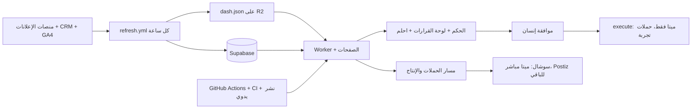
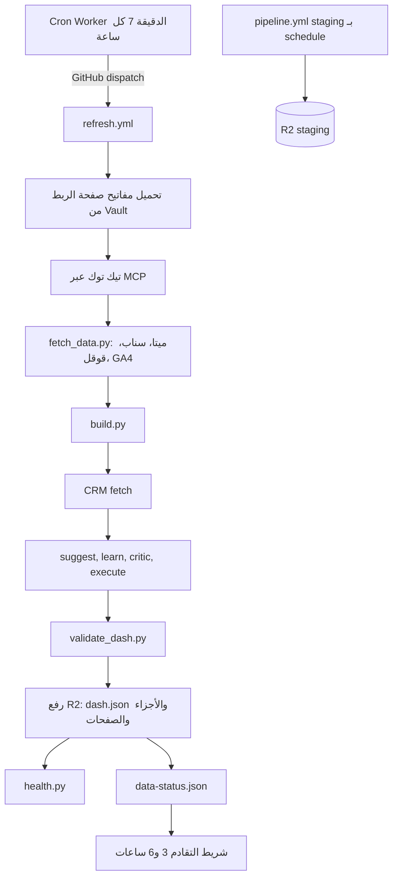
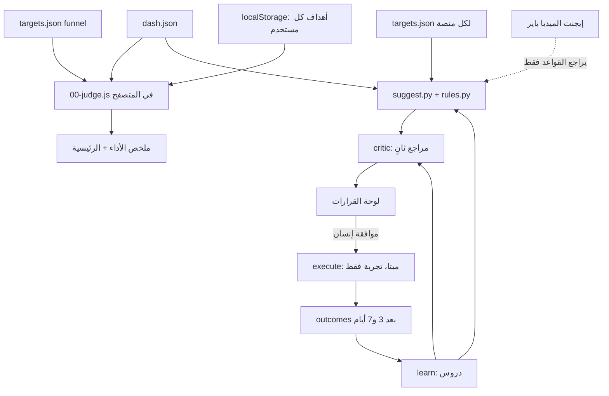
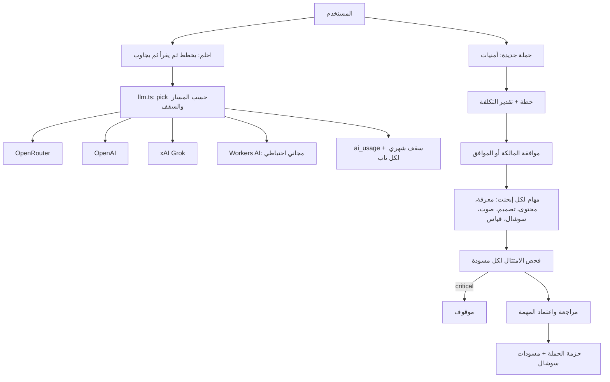
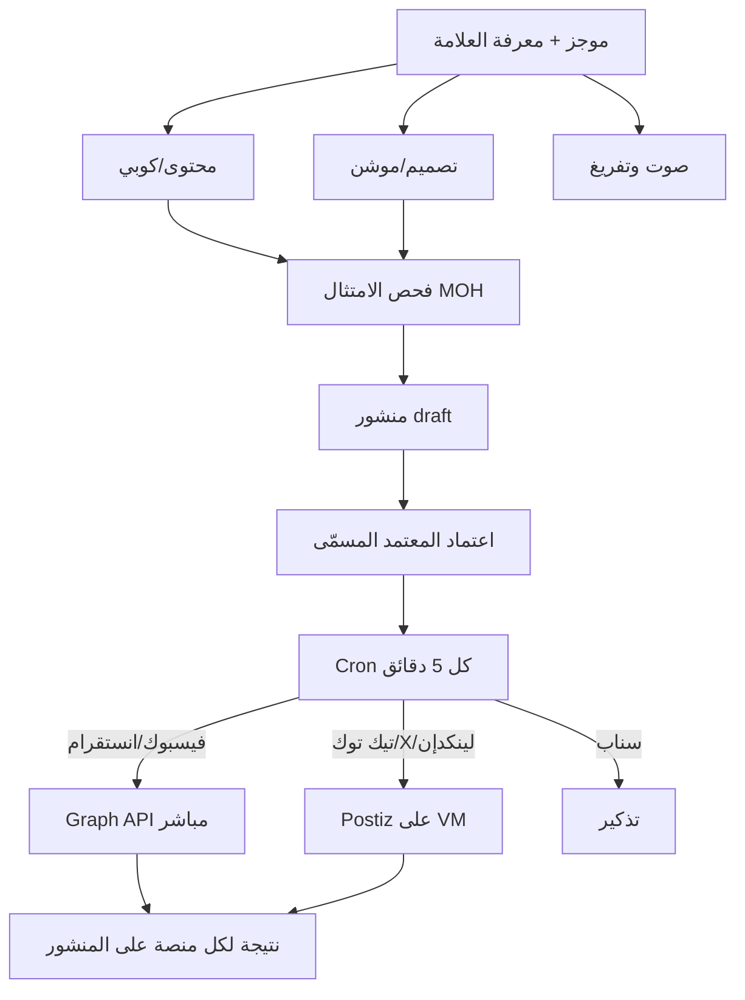
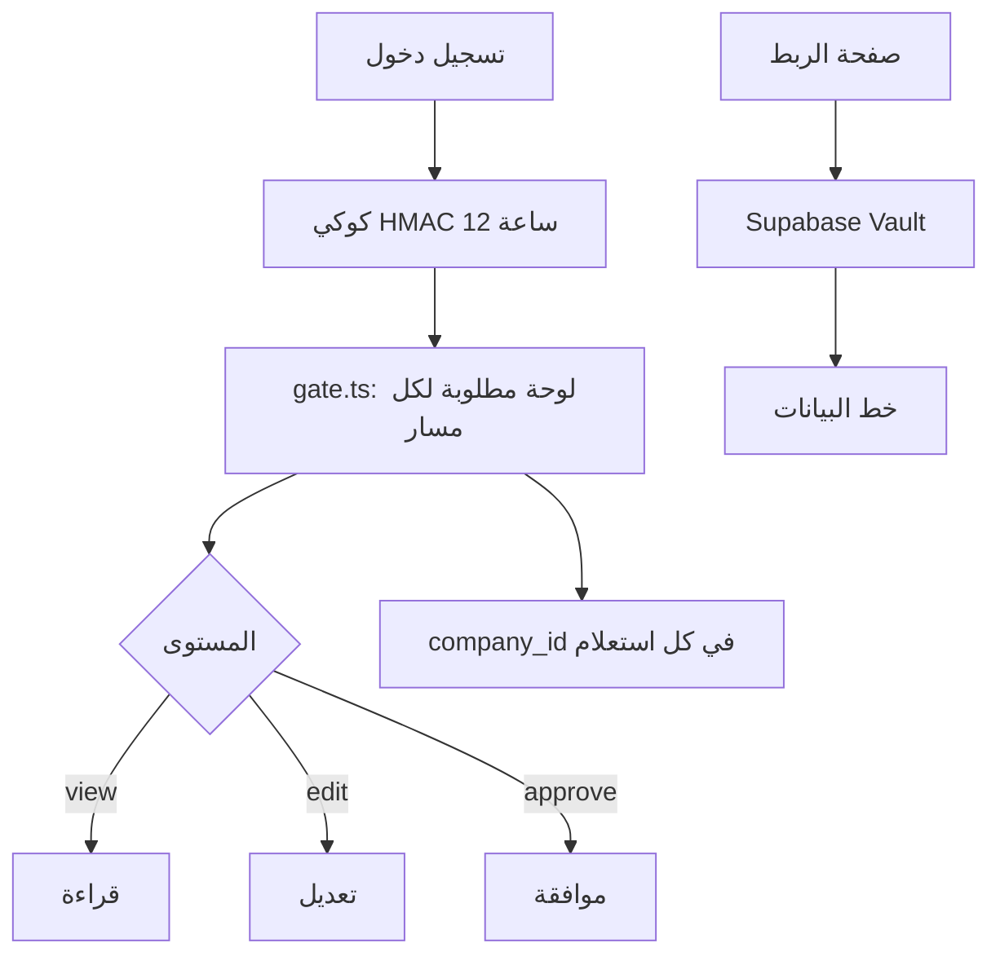
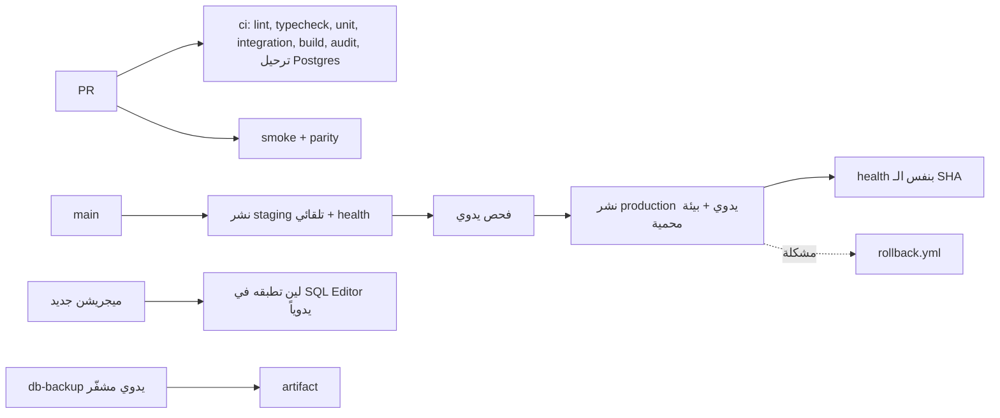
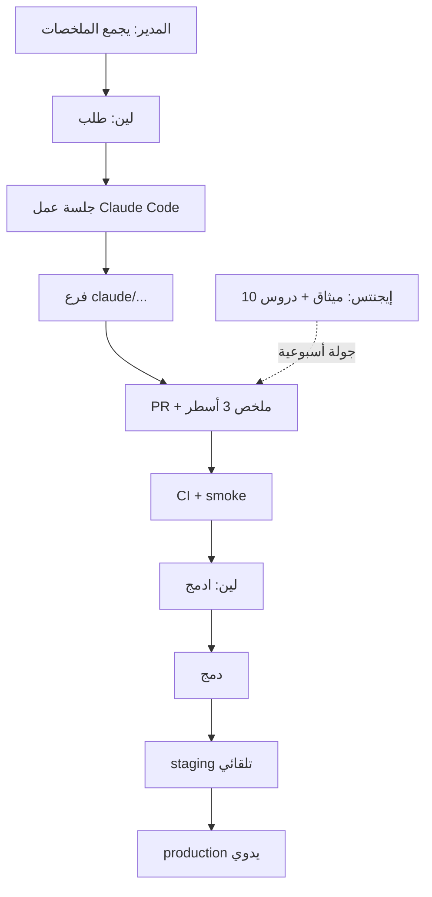

# مراجعة سير عمل النظام من البداية للنهاية

**التاريخ:** 2026-11-11 · **النوع:** قراءة فقط على الكود والإعدادات والـ workflows وسجل التشغيلات العام (ما تغيّر شي في الكود، ولا لمسنا الأسرار).
**القاعدة:** الريبو public، فلا أسرار ولا أرقام أعمال هنا. الأرقام المذكورة عدّادات تشغيل (ساعات، عدد تشغيلات) بس.

## الملخص التنفيذي

1. **أخطر ثغرة:** الحارس (فحص صحة البيانات) آخر خطوة في نفس الـ workflow اللي يسحب البيانات. لما فشلت أول خطوة (بعد إضافة فحص استثناء تيك توك بـ `exit 1`)، توقف السحب ساعات متتالية، والحارس ما اشتغل أصلاً، فما وصل أي إيميل. اللي كشفه شريط «البيانات قديمة» في الواجهة بعد 6 ساعات، مو تنبيه.
2. **تعارض مع قرار لين:** `refresh.yml` يشغّل خطوة `execute` فعلية على ميتا (إيقاف إعلان أو مجموعة، وتراجعه) ومفتاح ميتا يُطلب بصلاحية `ads_management`. هذا كتابة على حساب إعلاني، والقرار «قراءة فقط». مقيّدة بحملات تجربة وزر طوارئ وموافقة ومراجع، لكنها تبقى استثناءً يحتاج قرار صريح من لين أو إزالة.
3. **بيانات خاصة في مكان عام:** فرع `tiktok-data` ما زال موجوداً في الريبو العام وفيه بيانات تيك توك (R-16 في `docs/review-2026-11.md` مفتوح)، و`refresh.yml` ما زال يقرؤه كاحتياط، مع أن القرار «تيك توك على MCP».
4. **الإيجنتس العشرة معرّفون بس ما اشتغلوا:** سجلات الدروس كلها فاضية وما فيه جولة مرفوعة ولا مجدوِل يشغّلهم في الريبو.
5. **هشاشة تشغيلية:** نشر الميجريشنز يدوي من SQL Editor، والنسخ الاحتياطي يدوي، وقاعدة الامتثال في السوشال تنبيه بس.

## نظرة عامة

---

## 1) خط البيانات

**يشتغل صح**
- Worker Cron هو المشغّل (لأن `schedule` في GitHub ما اشتغل للريبو). نتيجة الـ dispatch تُكتب في R2 وتظهر في صحة الداتا.
- `concurrency` بدون إلغاء، وكاش لآخر بيانات، وسحب آخر أيام بس بالساعة وسحب أعمق مرة باليوم.
- التحقق من `dash.json` قبل الرفع، وترتيب الرفع (الأجزاء ثم الملف الرئيسي)، وقراءة التقادم من R2 بدون Supabase.

**الفجوات (بالخطورة)**
| # | الخطورة | الفجوة |
|---|---|---|
| 1.1 | عالية | الحارس داخل الـ workflow نفسه: أي فشل مبكر أو تعليق أو إلغاء يعني ما فيه تنبيه. لا يوجد مراقب خارجي (dead-man switch) يتأكد أن `dash.json` تحدّث. |
| 1.2 | عالية | `continue-on-error` على CRM وsuggest وlearn وcritic وexecute وتيك توك: فشلها صامت (CRM بس له تنبيه تقادم). قرارات قديمة قد تُعرض كأنها حديثة. |
| 1.3 | عالية | مسار واحد للتشغيل: Worker Cron ثم توكن dispatch. انتهاء التوكن أو تعطله يوقف كل شي، والتنبيه الوحيد شريط في الواجهة. |
| 1.4 | متوسطة | تيك توك: احتياط فرع `tiktok-data` العام (بيانات خاصة، R-16) وكود سحب مباشر بتوكن API (`pipeline/tiktok/fetch.py`) بجانب MCP. كلاهما يخالف «تيك توك على MCP» أو يخفّفه. |
| 1.5 | متوسطة | فحص استثناء حساب تيك توك الثاني صار تحذيراً بدل فشل: لو الأسرار غابت قد يدخل حساب شركة ثانية. وفلتر ثانٍ بمعرّفات في `01-base.js` على الصفحة نفسها (مذكور في `docs/tiktok-exclusion.md` كغير منقول). |
| 1.6 | متوسطة | تنبيه الإيميل يوصل 4 مرات باليوم بس، ويعتمد على إشعارات GitHub الشخصية. |
| 1.7 | منخفضة | `pipeline.yml` (staging) على `schedule` الذي لا ينتظم، فالتجريب قد يعرض بيانات أقدم من الإنتاج. |
| 1.8 | منخفضة | Audience Network و`meta_whatsapp` تنسحب وتنحسب في المجاميع وتُخفى في العرض فقط (`HIDDEN` مكرر في 4 أماكن). لو قرار لين «لا يدخلون» فالمطلوب إيقافهم عند السحب، مو إخفاؤهم. |

**القطع المكررة/اليتيمة:** مفتاح `HIDDEN` معرّف في `01-base.js` و`numbers.ts` و`facts.ts`؛ فرع `tiktok-data`؛ `pipeline/tiktok/fetch.py` (مسار API مباشر).

---

## 2) الحكم والقرارات

**يشتغل صح:** قواعد لين ثابتة في `rules.py` (حد أدنى أيام قبل الإيقاف، سقف تغيير ميزانية، ممنوع Traffic)، بصمة (digest) تبطل الموافقة لو تغيّر الاقتراح، مراجع ثانٍ، سجل تدقيق، وحدّ 48 ساعة للموافقة.

**الفجوات**
| # | الخطورة | الفجوة |
|---|---|---|
| 2.1 | عالية | **منطقان للحكم:** الحكم على الرحلة (`00-judge.js`) يشتغل في المتصفح وأهدافه تتعدّل محلياً لكل مستخدم، بينما `suggest.py` يعتمد أهداف `targets.json` (وإذا فاضية يستخدم متوسط 30 يوم). نفس الإعلان قد يكون «كارثة» في الواجهة وما يظهر له اقتراح، أو العكس. ملاحظة: الوثيقة نفسها تقول إن الحكم «يحتاج نسخة في الخادم». |
| 2.2 | عالية | إيجنت الميديا باير يقترح ويراجع القواعد بس، وما فيه قناة تربط **خرج الحكم** بـ **مدخل الاقتراحات** (الحكم لا يولّد اقتراحات). الإيجنت ما يشتغل على حكم الرحلة أصلاً. |
| 2.3 | عالية | `execute` فعلي على ميتا (انظر الملخص، البند 2). ميثاق الميديا باير يقول «وضع execute يبقى جافاً»، و`modules.json` فيه `execute: true`: تناقض بين الميثاق والإعداد. |
| 2.4 | متوسطة | نوافذ «آخر 7 و30 يوم» في الاقتراحات تشمل يوماً ناقصاً، وتواريخ outcomes بـ UTC (R-19, R-20 مفتوحة بانتظار موافقة لين لأنها تغيّر أرقاماً). |
| 2.5 | متوسطة | مسار `budget_up` و`new_campaign` و`pause_campaign` معرّف في القواعد بس غير منفّذ، فيظهر للمستخدم اقتراح لا ينفّذه النظام (تنفيذ يدوي). يحتاج توضيحاً في الواجهة. |
| 2.6 | منخفضة | `judge.test.ts` ويُنسخ جدول القواعد بين `pipeline/dash` وTS عبر استيراد، وهذا جيد، لكن فيه نسخة `.d.ts` تُصان يدوياً. |

---

## 3) الإيجنتس داخل المنتج

**يشتغل صح:** سقف شهري افتراضي يفشل مغلقاً، تسجيل التكلفة، فصل المسارات، لا حفظ لنصوص الأسئلة، احلم قراءة فقط، الامتثال يوقف مخرجات الحملة، والمسودات تُحفظ `draft`.

**الفجوات**
| # | الخطورة | الفجوة |
|---|---|---|
| 3.1 | عالية | **الأسعار غير مطابقة بفاتورة** (`verified: false`) فكل السقوف والتكاليف تقديرية، وبوابة PRD (فرق أقل من 5%) لم تُمرَّر. |
| 3.2 | متوسطة | **تنفيذ الحملة مربوط بالمتصفح** (خطوة لكل طلب، بلا Cron): إغلاق الصفحة يوقف الحملة. هذا مذكور كتطوير لاحق. |
| 3.3 | متوسطة | تكلفة غير مسجّلة: Debugger (Claude مباشر)، بحث Grok، الصور (تقدير ثابت)، واستدعاءات بلا سياق مستخدم (Cron). السقف لا يغطيها كلها. |
| 3.4 | متوسطة | السقف مخزّن لكل Isolate بدقيقة تأخير: يمكن تجاوزه مؤقتاً. وحد المحادثات في المدير سباق (R-23). |
| 3.5 | متوسطة | تعدد المزودين (4) مع قرار توجيه بين الوثائق والكود (`PROVIDER` في `llm.ts` مقابل ما في `ai-providers.md`) قد يختلف: مصدر الحقيقة يجب أن يكون واحداً. |
| 3.6 | منخفضة | ربط Paperclip ما اكتمل (هيكل مستهدف فقط)، ويحتاج جهازاً شغالاً ونفقاً، فالمدير ما يوزّع فعلياً. |
| 3.7 | منخفضة | حكم الرحلة ما انربط بخطة القياس بعد تشغيل الحملة (مذكور كـ«للتطوير لاحقاً»). |

---

## 4) الإنتاج والنشر

**يشتغل صح:** قاعدة الموافقة عندنا مو عند Postiz، منشور غير معتمد ما يستدعي أي محرك، وقائمة امتثال واحدة لكل التابات مع مصادر رسمية.

**الفجوات**
| # | الخطورة | الفجوة |
|---|---|---|
| 4.1 | عالية | **الامتثال في السوشال تنبيه فقط** (قرار لين) ولا يوجد حاجز في `social/cron.ts`: منشور فيه مخالفة critical يُنشر تلقائياً إذا اعتمده معتمد. بينما مسار الحملات يوقف critical. سلوكان مختلفان لنفس القاعدة (PR #237 يضيف تجاوزاً يدوياً للحملات). |
| 4.2 | عالية | الامتثال يفحص النص فقط: لا فحص للصور والفيديو والصوت (قبل/بعد، وجوه مرضى، ادعاءات في الموشن)، وهي مصدر مخالفات وزارة الصحة الأشيع. |
| 4.3 | متوسطة | Postiz نقطة فشل منفصلة (VM، قاعدة، Temporal) مع نسخ احتياطي يدوي مطلوب من لين، وبدون مراقبة في الريبو. تيك توك قد يبقى `SELF_ONLY` قبل تدقيق التطبيق. |
| 4.4 | متوسطة | ربط ميتا للنشر (`meta_pages`) مفتاح مستقل عن مفتاح الإعلانات، ينتهي بعد نحو 60 يوماً حسب النص، وما فيه تنبيه استباقي بالانتهاء. |
| 4.5 | منخفضة | أوامر Cron الخمس دقائق تجمع السوشال والرصد والتفريغ في `Promise.allSettled`: تأخر أحدها لا يوقف الباقي، لكن الفشل يظهر في سجل Worker بس. |

---

## 5) الهوية والصلاحيات

**يشتغل صح:** إعادة قراءة الملف الشخصي في كل نداء، فحص نفس الأصل للكتابة، عزل الشركات (R-01 إلى R-03 مصلّحة)، RLS مقفل مع سحب صلاحيات anon، المفاتيح في Vault ولا ترجع للمتصفح.

**الفجوات**
| # | الخطورة | الفجوة |
|---|---|---|
| 5.1 | عالية | لا حدّ لمعدّل محاولات الدخول وإعادة التعيين (R-25، مفتوحة، قاعدة Cloudflare). |
| 5.2 | متوسطة | جداول القرارات والربط ما فيها `company_id` (Well فقط بالكود). أي شركة ثانية تتطلب مهاجرة قبل أي توسع. |
| 5.3 | متوسطة | مفتاح ميتا بصلاحية `ads_management` مع قرار القراءة فقط (يتقاطع مع 2.3). الأفضل مفتاحان: قراءة للسحب، وكتابة معزول لحملات التجربة أو بدون كتابة. |
| 5.4 | منخفضة | `OWNER_EMAIL` في `wrangler.jsonc` العام: قرار مقبول موثّق (R-10)، لكنه يسهّل التصيّد على المالكة. |
| 5.5 | منخفضة | `login_failed` يخزّن مدخلات (مصلّح في #159)، يبقى يستحق إعادة فحص بعد أي تعديل على المسار. |

---

## 6) الهندسة والتسليم

**يشتغل صح:** بوابات CI قوية، smoke على نفس الـ commit قبل النشر، فحص الصحة مقابل SHA، رجوع بضغطة، النسخة المشفّرة، وإجراء تشغيل موثّق في `docs/runbook.md`.

**الفجوات**
| # | الخطورة | الفجوة |
|---|---|---|
| 6.1 | عالية | **النسخ الاحتياطي يدوي فقط** وبقاء الـ artifact 3 أيام: لا جدولة ولا اختبار استعادة. وأي مشكلة في المفتاح أو العبارة تظهر وقت الحاجة. |
| 6.2 | عالية | **الميجريشنز تدوية** (SQL Editor) بلا سجل «طُبّقت»: الكود قد ينشر قبل المهاجرة. صحة الداتا تكشف النواقص بعد وقوعها بس. |
| 6.3 | متوسطة | تعليمات `main`: بدون حماية فرع وإلزام CI (قرار خطة مجانية ADR-0005). يخفّف ذلك أن لين وحدها تكتب، لكن جلسات متعددة بتفويضات تدفع PRs بسرعة (نحو 40 PR دُمجت في يوم بعد قراءة سريعة). |
| 6.4 | متوسطة | هيجين الريبو: عشرات الفروع المتراكمة، وPR تبعيات معلّق، ومؤشرات أن حذف فرع `tiktok-data` وإعادة كتابة التاريخ (R-16, R-17) بانتظار قرار. |
| 6.5 | متوسطة | staging يقرأ بيانات الإنتاج المصدّرة (read-only) لكن غير مجدول بانتظام، وأسرار Supabase مشتركة؟ يحتاج التأكد أن staging لا يكتب على قاعدة الإنتاج. |
| 6.6 | منخفضة | `execute-smoke.yml` يشارك `concurrency: refresh` مع التحديث: تشغيل يدوي قد يؤخر الساعة. |
| 6.7 | منخفضة | `.claude/settings.json` يسمح لأمر نشر production بدون سؤال: يخالف قاعدة «سطر واحد للين قبل كل نشر production» (ADR-0005)، ولو أن بيئة production تطلب موافقة. |

---

## 7) سير عمل الفريق

**يشتغل صح:** ميثاق واضح (نطاق، مهام، قياس، جولة، ترتيب أولويات: الأمان ثم الأرقام ثم الاستقرار)، قاعدة «لا دمج ذاتي»، ومعرّفات `.claude/agents` متطابقة مع `docs/agents`.

**الفجوات**
| # | الخطورة | الفجوة |
|---|---|---|
| 7.1 | عالية | **الجولة الأسبوعية ما تُشغَّل:** لا مجدوِل في الريبو، وسجلات الدروس العشرة فاضية، ولا مجلد `rounds/`، وعملياً تعتمد على جلسات تُطلق يدوياً. كذلك «المدير يجمع الملخصات» غير مؤتمت. |
| 7.2 | عالية | **تداخل الملكية:** الميديا باير والمدقق والبيانات يشتركون في `suggest` و`critic` و`judge` و`dash`. لا مالك لمنطق الحكم الموحّد، وميثاق المدقق يعدّل `critic` والميديا باير يملك `suggest`، فاصطدام PRs متوقع. |
| 7.3 | متوسطة | حجم المراجعة على لين: PRs كثيرة بلا فرز حسب الخطورة. المطلوب أن المدير يصنّفها (آمن/يحتاج نظر) فعلاً. |
| 7.4 | متوسطة | لوب التعلّم لكل تاب (L2 إلى L4) غير مكتمل: لا `learn()` لغير الإعلانات، ولا تصدير playbook (الريبو غير موجود)، والكوبي رايتر ينتظر تحقق هوية ميتا من لين. |
| 7.5 | منخفضة | تسمية: المدير (maestro) في المنتج مقابل «المدير» في ميثاق الجلسات (مجمّع الملخصات): نفس الاسم لدورين. |

---

## القطع اليتيمة والتكرار (ملخص)
- `HIDDEN` (Audience Network وmeta_whatsapp) في 4 ملفات.
- `pipeline/tiktok/fetch.py` ومسار API المباشر، وفرع `tiktok-data`، بجانب MCP.
- هدفان للحكم (`funnel` و`meta.cpl`) ومحركان (JS وPython).
- `CRM` و`debugger` يقيسان الأيام بمنطقتين زمنيتين (UTC مقابل الرياض).
- تعريف الإيجنتس مكرر بين `docs/agents/*.md` و`.claude/agents/*.md` (نسخ يدوي في نفس الـ PR).

## تعارض مع قرارات لين
| القرار | الحالة |
|---|---|
| حسابات الإعلانات قراءة فقط | **مخالف جزئياً**: `execute` يكتب على ميتا (تجربة فقط) ومفتاح ميتا بصلاحية كتابة. |
| لا Audience Network ولا meta_whatsapp | **غامض**: يُسحبان ويُحسبان في المجاميع ويُخفيان في العرض فقط. |
| تيك توك على MCP | **مخفّف**: MCP أساسي، لكن الاحتياط فرع عام وكود API مباشر. |
| الامتثال تنبيه بس | **متّبع** في السوشال، **أشد** في الحملات (توقف critical). |

---

## أول 10 إصلاحات (بالأولوية)

| # | الإصلاح | يعالج | الجهد | الإيجنت المناسب |
|---|---|---|---|---|
| 1 | مراقب خارجي لتقادم `dash.json` (Cron في Worker يفحص عمر الملف كل ساعة ويرسل إيميل/إشعار لو تجاوز 3 ساعات)، وتشغيل health حتى عند الفشل (`if: always()`) | 1.1, 1.3 | صغير (نصف يوم) | السرعة والاستقرار |
| 2 | قرار لين حول `execute`: إما إزالته من `refresh.yml` أو توثيقه كاستثناء رسمي مع مفتاح كتابة معزول لحملات التجربة، وتصحيح ميثاق الميديا باير | 2.3, 5.3 | صغير + قرار | الأمان والمستخدمون (والميديا باير للميثاق) |
| 3 | جعل فشل خطوات CRM وsuggest وcritic وlearn مرئياً: ملخص يكتب حالة كل خطوة في `data-status.json` ويظهر في صحة الداتا | 1.2 | متوسط (يوم) | البيانات وCRM |
| 4 | إنهاء تيك توك على MCP: حذف مسار `fetch.py` المباشر، وإيقاف قراءة `tiktok-data`، ثم حذف الفرع وتنظيف التاريخ (بقرار لين) | 1.4, 6.4 | متوسط (يوم) + قرار | البيانات وCRM |
| 5 | حكم موحّد في الخادم: نقل `00-judge` لدالة مشتركة تعتمد `targets.json` فقط، وربط الحكم بتوليد/ترتيب الاقتراحات | 2.1, 2.2 | كبير (3 إلى 5 أيام) | الميديا باير (مع المدقق للمراجعة) |
| 6 | نسخ احتياطي مجدول (أسبوعي على الأقل) مع اختبار استعادة شهري، ورفع مدة الاحتفاظ لخارج GitHub (R2 خاص مشفّر) | 6.1 | صغير إلى متوسط | السرعة والاستقرار |
| 7 | تتبع تطبيق الميجريشنز: جدول `schema_migrations` وفحص في `/api/health` يفشل نشر production لو ناقصة | 6.2 | متوسط | البيانات وCRM |
| 8 | حاجز امتثال اختياري للمنشورات: critical يوقف الجدولة التلقائية (مفتاح تشغيل تقرره لين)، وإضافة فحص أولي لنصوص الصور/الفيديو المولّدة | 4.1, 4.2 | متوسط (1 إلى 2 يوم) | السوشال والنشر (مع الأمان) |
| 9 | تشغيل فعلي للجولة الأسبوعية: مهام مجدولة (routines) لكل إيجنت، ومجمّع ملخصات يفرز PRs حسب الخطورة، وملف `rounds/` | 7.1, 7.3 | متوسط | المدقق (للتجميع) والذكاء الاصطناعي والتوجيه |
| 10 | مطابقة أسعار الذكاء الاصطناعي مع فاتورة فعلية وإكمال تسجيل ما نقص (Debugger، Grok، الصور) وتوحيد مصدر التوجيه | 3.1, 3.3, 3.5 | متوسط | الذكاء الاصطناعي والتوجيه |

**ملاحظات تنفيذ:** البنود 1 و2 و4 و6 تحتاج قرار أو مفتاح من لين قبل الدمج. ما فيه بند يحتاج تغيير في حسابات الإعلانات.

## حدود هذه المراجعة
- ما اطّلعنا على إعدادات Supabase وCloudflare ولا قيم الأسرار، فحالة الميجريشنز المطبّقة وصلاحيات المفاتيح الفعلية غير مؤكدة (الاستنتاج من الكود والوثائق).
- سجل تشغيلات `refresh` المذكور من واجهة GitHub العامة: ساعات الفشل المتتالية سببها المباشر الخطوة الأولى في تلك النسخة، وأُصلحت لاحقاً (تحذير بدل فشل).
- ما فُحص كل ملف في `src/modules`: المسارات مغطاة من نقاط الدخول والوثائق والاختبارات.
